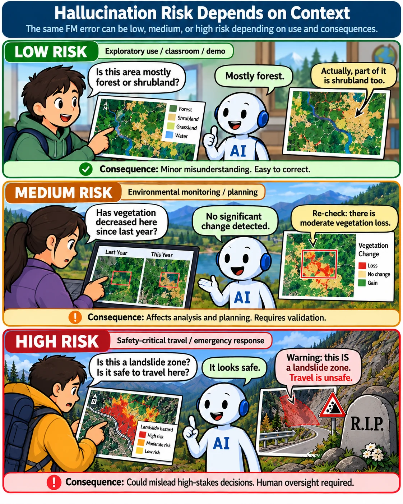

# Foundation Model Risks

This section is the risk register for foundation models in PROTEUS. FMs support generalisation across Copernicus applications, and they bring risks that differ from those of task-specific models. The task description of T1.4 & T2.4 names hallucination, overfitting to training distributions, opacity in large models, security vulnerabilities such as adversarial attacks or model inversion, and geoprivacy and potential geopolitical sensitivities in satellite-based inferences as the points needing particular attention. For each risk, the subsections below describe what it is, how it appears in EO, and which principles and strategies address it. The consortium also recognises the dual-use potential of advanced AI systems, which is handled through governance and access conditions. The register is reviewed and extended in each version of the guideline.

## Hallucination

Hallucination is the generation of content that is plausible but not supported by data or fact. In PROTEUS it concerns generative components, such as gap-filling and super-resolution, that can invent spatial detail, and language-based agents in the agentic reasoning layer that can produce unsupported statements. In decision support, for example during a flood or wildfire, a fabricated feature or statement can be mistaken for an observation. This subsection describes the forms hallucination takes, how it can be detected (consistency checks, uncertainty estimates, grounding in source data and knowledge graphs), and what users must be told about generated content.

| **Risk tier** | **Description** | **FM hallucination** |
|-----------------|----------------------|----------------------|
| **Low** | Limited consequences, with errors readily detectable and correctable. | An incorrect land-cover description in an exploratory application with no operational consequences. |
| **Medium** | Errors may affect analytical reliability, interpretation, or planning, but can be identified and corrected through validation. | An incorrect vegetation-change assessment influencing environmental monitoring results. |
| **High** | Errors could substantially affect safety, critical infrastructure, sensitive information, or consequential decisions. | Incorrectly identifying flood-exposed infrastructure during emergency response, potentially misleading operational decisions. |

## Overfitting

Overfitting occurs when a model fits its training distribution so closely that performance drops on new regions, seasons, sensors or events. FMs pretrained on large archives can still overfit to dominant geographies, land cover classes or acquisition conditions, which makes benchmark results optimistic for the under-represented cases that PROTEUS serves. This subsection covers the causes (data imbalance, spatial autocorrelation, leakage between training and test areas), the evidence expected from developers (spatially blocked validation, out-of-distribution and domain-shift tests), and the link to out-of-distribution detection by comparing embeddings, led by WUR on UC2 data.

## Model Opacity

Model opacity is the difficulty of understanding why a large model produces a given output. Large FMs with many parameters and multimodal inputs are hard to inspect, which limits trust, debugging, auditing and the ability of users to challenge results. This subsection describes the dimensions of the problem (opacity of the model, of its training data and of its development process), what the project requires in response (documentation through RAI metadata, explanation methods adapted to EO, and communication suited to non-expert users), and the limits of explanation methods, which can themselves be misleading and need to be tested.

## Adversarial Attacks

Adversarial attacks are deliberate manipulations that make a model fail or reveal protected information. They include evasion attacks (perturbed inputs that change predictions), data poisoning, model inversion and membership or attribute inference (recovering information about training data), and model extraction. For EO, the concerns include tampered imagery or spoofed sensor data feeding operational services, and attacks on shared FMs. This subsection describes these threats, the assets at risk (models, data, pipelines, services) and the expectation that security testing is part of validation. Because FMs from other partners may be background IP, the testing methods are designed to work with limited access to model internals.

## Geoprivacy

Geoprivacy is the protection of people and places from harm caused by locational information. High-resolution imagery and derived products can reveal the movement of individuals or groups, the location of vulnerable communities or critical infrastructure, and sensitive activities, even when no personal data in the GDPR sense is present. Satellite-based inferences can also carry geopolitical sensitivities, which matters for use cases such as displacement monitoring (UC1). This subsection describes the risk, the cases where it applies, and the expected controls, such as spatial aggregation or coarsening, access restrictions, review of outputs before release, and geoprivacy fields in the RAI metadata.

## Dual-Use

Dual-use risk is the possibility that models and outputs built for civil Copernicus services are used to cause harm, for example for surveillance, targeting or the profiling of vulnerable groups, or that capabilities developed for one purpose are repurposed for another. The consortium recognises this potential and commits to develop models under strict governance and access conditions aligned with EU values. This subsection describes the forms of dual-use that are relevant to EO (high-resolution monitoring of people and sites, inference of sensitive activities, model misuse), the factors that raise the risk (resolution, revisit time, linkage to other data, openness of model weights), and the safeguards expected: a documented intended-use statement, review of sensitive use cases such as displacement monitoring (UC1), access conditions for models and data, and escalation to the External Advisory Board.
